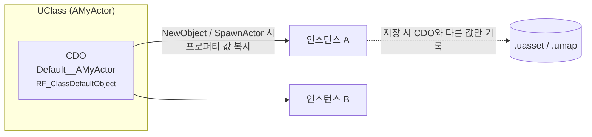

# CDO (Class Default Object)

> 공부한 날짜: 2026-10-22 · 참고 자료: 엔진 소스 `Engine/Source/Runtime/CoreUObject/` (`Class.h`, `UObjectGlobals.cpp`), Week8 엔진 `Source/Runtime/UObject/Class.h`

## 한 줄 요약

**CDO는 클래스마다 하나씩 있는 "기본값 견본 객체"다.**
`UClass`가 들고 있고, 생성자를 한 번 실행한 결과를 저장해 둔다. 새 객체를 만들 때 이 견본의 프로퍼티 값을 복사해 초기화하고, 저장할 때는 견본과 **다른 값만** 기록한다.

## 전체 그림



## 핵심 개념

### 1. CDO는 무엇인가

- 모든 `UClass`는 `ClassDefaultObject`라는 멤버로 자기 클래스의 객체 하나를 갖고 있다. 이게 CDO다.
- 이름은 `Default__클래스이름`(예: `Default__AMyActor`)이고, 플래그 `RF_ClassDefaultObject`가 붙는다.
- **게임 월드에 존재하는 객체가 아니다.** `BeginPlay`도, `Tick`도 불리지 않는다. 오직 "이 클래스의 기본값은 이렇다"를 보관하는 용도다.

### 2. 언제 만들어지나

- 모듈이 로드되고 클래스가 등록될 때, 엔진이 각 `UClass`의 CDO를 만든다(`UClass::GetDefaultObject` → `CreateDefaultObject`).
- 이때 **클래스의 생성자가 실행된다.** 그래서 에디터나 게임을 켜기만 해도, 레벨에 아무것도 배치하지 않은 클래스의 생성자까지 호출된다.

!!! warning "생성자에 게임 로직을 넣으면 안 되는 이유"
    생성자는 CDO를 만들 때도 실행된다. 이 시점에는 월드(`GetWorld()`)도 없고, 다른 객체들도 준비되지 않았을 수 있다.
    생성자에는 **기본값 설정**과 **`CreateDefaultSubobject`로 컴포넌트 만들기**만 두고, 실제 동작은 `BeginPlay`나 `PostInitializeComponents`에서 한다.

### 3. 새 객체를 만들 때: 견본에서 복사

```cpp
AMyActor* A = GetWorld()->SpawnActor<AMyActor>();
UMyObject* B = NewObject<UMyObject>(Outer);
```

- `NewObject` / `SpawnActor`는 내부에서 `StaticConstructObject_Internal`을 거친다.
- 템플릿(archetype)을 따로 주지 않으면 **CDO가 템플릿**이 된다.
- 메모리를 잡고 생성자를 실행한 뒤, `FObjectInitializer`가 소멸되면서(`PostConstructInit` → `InitProperties`) 템플릿의 프로퍼티 값을 새 객체에 덮어쓴다. 그래서 최종 값은 **템플릿(CDO) 기준**이 된다.
- `CreateDefaultSubobject`로 만든 컴포넌트(서브오브젝트)도 CDO에 하나씩 있고, 인스턴스마다 자기 사본을 받는다.

### 4. 저장할 때: 차이만 기록 (델타 직렬화)

- 레벨에 배치된 액터를 저장하면, **CDO 값과 다른 프로퍼티만** 파일에 쓴다.
- 장점 두 가지:
    1. 파일이 작아진다.
    2. 나중에 클래스의 기본값을 바꾸면, 그 값을 **따로 바꾸지 않은 인스턴스들은 새 기본값을 자동으로 따라간다.**
- 에디터 디테일 패널에서 기본값과 다른 프로퍼티 옆에 나오는 "기본값으로 되돌리기(↺)" 화살표가 바로 이 비교 결과다.

### 5. 블루프린트와 Config

- 블루프린트 에디터의 **Class Defaults** 패널은 그 블루프린트가 만든 클래스(`UBlueprintGeneratedClass`)의 **CDO를 편집하는 화면**이다.
- `UPROPERTY(Config)` 값은 `.ini` 파일에서 읽어 **CDO에 채워진다**(`LoadConfig`). 그래서 새 인스턴스는 자동으로 설정 파일 값을 갖고 태어난다.

### 6. 코드에서 CDO 쓰기

| 함수 | 용도 |
|---|---|
| `GetDefault<T>()` | `T`의 CDO를 **읽기 전용**(`const T*`)으로 가져온다. 인스턴스 없이 기본값 확인 |
| `GetMutableDefault<T>()` | 수정 가능한 CDO. 설정 객체(`UDeveloperSettings` 등) 외에는 거의 쓰지 않는다 |
| `SomeClass->GetDefaultObject<T>()` | `UClass*`만 있을 때(예: `TSubclassOf<T>`) 그 클래스의 CDO |
| `Obj->HasAnyFlags(RF_ClassDefaultObject)` / `Obj->IsTemplate()` | 지금 이 객체가 CDO(또는 템플릿)인지 확인 |

```cpp
// TSubclassOf로 받은 클래스의 기본 체력을, 스폰하지 않고 읽기
TSubclassOf<AEnemy> EnemyClass = ...;
const float DefaultHP = EnemyClass->GetDefaultObject<AEnemy>()->MaxHP;
```

!!! danger "런타임에 CDO를 바꾸면"
    CDO를 수정하면 **그 뒤에 만들어지는 모든 인스턴스**의 기본값이 바뀐다. 의도한 게 아니라면 큰 버그가 된다. 기본값은 읽기만 하자(`GetDefault`).

## 내 엔진(Week8)과 비교

Week8 엔진의 `UClass`(`Source/Runtime/UObject/Class.h`)에도 CDO 개념이 들어가 있다.

```cpp
UObject* UClass::GetDefaultObject()
{
    if (!DefaultObject)
        DefaultObject = Constructor(UObject::operator new(ClassSize));
    return DefaultObject;
}
```

| 항목 | 언리얼 | Week8 엔진 |
|---|---|---|
| 보관 위치 | `UClass::ClassDefaultObject` | `UClass::DefaultObject` |
| 생성 시점 | 클래스 등록 직후 (엔진 시작 시) | 처음 `GetDefaultObject()`를 부를 때 (지연 생성) |
| CDO 표시 | `RF_ClassDefaultObject` 플래그, `Default__` 이름 | 표시 없음 |
| 새 객체 초기화 | CDO 값을 복사(`InitProperties`) | CDO를 쓰지 않음 — 생성자만 실행 |
| 프로퍼티 복사 | 리플렉션(`FProperty`)으로 프로퍼티별 복사 | `CopyProperties`(프로퍼티별 `memcpy`)가 있지만 **"보류"** 상태 |
| 저장 | CDO와 다른 값만 기록 | 해당 없음 |

- Week8 엔진은 CDO를 만들 수는 있지만 **아직 견본으로 쓰지 않는다.** 현재 소스에서 `GetDefaultObject`를 호출하는 곳이 없다.
- `CopyProperties`를 `memcpy`로 하면, `FString`이나 `TArray`처럼 힙 메모리를 가진 프로퍼티는 포인터만 복사돼서 두 객체가 같은 메모리를 공유하게 된다(얕은 복사). 언리얼은 `FProperty::CopyCompleteValue`처럼 **타입별 복사 함수**를 써서 이 문제를 피한다. 보류된 이유가 이것일 가능성이 크다.

## 코드로 확인한 것

- [x] Week8 엔진 `UClass::GetDefaultObject` 구현 확인 (지연 생성, 사용처 없음)
- [ ] 언리얼 `UClass::GetDefaultObject` → `CreateDefaultObject` 흐름 따라가기
- [ ] `StaticConstructObject_Internal`에서 템플릿이 CDO로 정해지는 부분 찾기
- [ ] 에디터에서 블루프린트 Class Defaults를 바꾸고 배치된 인스턴스가 따라오는지 실험

## 헷갈렸던 점 / 남은 질문

- [ ] CDO와 **아키타입(archetype)**의 차이는? (레벨에 배치된 블루프린트 인스턴스의 템플릿은 무엇인가)
- [ ] 생성자 안에서 `CreateDefaultSubobject`로 만든 컴포넌트는 CDO와 인스턴스 사이에서 어떻게 대응되나?
- [ ] 블루프린트를 컴파일하면 CDO는 다시 만들어지나? 기존 인스턴스는 어떻게 갱신되나(재인스턴스화)?
- [ ] Week8 엔진에서 `CopyProperties`를 프로퍼티 타입별 복사로 바꾸려면 `FProperty`에 무엇이 더 필요할까?
