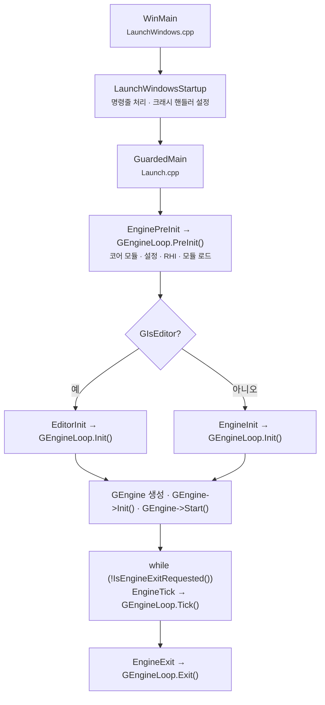

# 엔트리 포인트

> 공부한 날짜: 2026-10-21 · 참고 자료: 엔진 소스 `Engine/Source/Runtime/Launch/`

## 한 줄 요약

플랫폼별 `main`(Windows는 `WinMain`)은 거의 하는 일이 없고, 곧바로 `GuardedMain`으로 넘어간다.
`GuardedMain`은 전역 객체 `GEngineLoop`(`FEngineLoop`)의 **PreInit → Init → Tick 반복 → Exit**을 차례로 호출하는 것이 전부다.

## 전체 흐름



## 핵심 개념

### 1. 실행 파일의 시작점: Launch 모듈

- 엔트리 포인트는 게임 모듈이 아니라 엔진의 **Launch 모듈**(`Engine/Source/Runtime/Launch`)에 있다.
- 에디터(`UnrealEditor.exe`)든 패키징된 게임이든 모두 이 Launch 모듈을 링크한다. 그래서 시작 경로가 같다.
- 플랫폼마다 파일이 나뉜다.

| 플랫폼 | 파일 | 함수 |
|---|---|---|
| Windows | `Private/Windows/LaunchWindows.cpp` | `WinMain` |
| Linux | `Private/Unix/LaunchUnix.cpp` (버전에 따라 `Linux/`) | `main` |
| Mac | `Private/Mac/LaunchMac.cpp` | `main` (Cocoa 앱 델리게이트를 거쳐 실행) |
| 공통 | `Private/Launch.cpp` | `GuardedMain` |

!!! note "게임 모듈의 `IMPLEMENT_PRIMARY_GAME_MODULE`은 엔트리 포인트가 아니다"
    이 매크로는 게임 모듈을 엔진에 **등록**하는 역할만 한다. 실제 실행은 항상 Launch 모듈의 `main`에서 시작하고, 게임 모듈은 PreInit 중 모듈 로드 단계에서 불려 들어온다.

### 2. WinMain: 얇은 껍데기

Windows의 `WinMain`은 실제 작업을 `LaunchWindowsStartup`에 맡기고, 끝나면 `LaunchWindowsShutdown`을 부른다. `LaunchWindowsStartup`이 하는 일은 다음과 같다.

- `hInstance` 저장, 명령줄 문자열 정리
- 크래시 처리 준비: 디버거가 붙어 있지 않으면 SEH(`__try / __except`)로 감싼 `GuardedMainWrapper`를 통해 `GuardedMain`을 호출하고, 예외가 나면 크래시 리포터로 넘긴다
- 디버거가 붙어 있으면 바로 `GuardedMain`을 호출한다(디버거가 예외를 잡게 하려고)

### 3. GuardedMain: 엔진 생명주기의 뼈대

`Launch.cpp`의 `GuardedMain`은 짧고, 구조를 그대로 보여준다(의사 코드).

```cpp
int32 GuardedMain(const TCHAR* CmdLine)
{
    // 함수를 어떻게 빠져나가든 EngineExit()이 호출되도록 하는 가드
    struct EngineLoopCleanupGuard { ~EngineLoopCleanupGuard() { EngineExit(); } } CleanupGuard;

    int32 ErrorLevel = EnginePreInit(CmdLine);      // GEngineLoop.PreInit
    if (ErrorLevel != 0 || IsEngineExitRequested())
        return ErrorLevel;

#if WITH_EDITOR
    if (GIsEditor) ErrorLevel = EditorInit(GEngineLoop);
    else
#endif
        ErrorLevel = EngineInit();                   // GEngineLoop.Init

    while (!IsEngineExitRequested())
        EngineTick();                                // GEngineLoop.Tick

#if WITH_EDITOR
    if (GIsEditor) EditorExit();
#endif
    return ErrorLevel;
}
```

- `EnginePreInit / EngineInit / EngineTick / EngineExit`은 모두 `GEngineLoop`의 같은 이름 함수를 부르는 얇은 래퍼다.
- `GEngineLoop`는 `Launch.cpp`에 선언된 **전역 `FEngineLoop` 객체**다.

### 4. FEngineLoop의 네 단계

`FEngineLoop`(`LaunchEngineLoop.h/.cpp`)는 `IEngineLoop`를 구현한다.

| 단계 | 하는 일 |
|---|---|
| **PreInit** | 명령줄·설정(`GConfig`) 로드, 로그·플랫폼 초기화, `CoreUObject` 등 코어 모듈 로드, TaskGraph·스레드 준비, RHI 초기화, 셰이더 준비, 로딩 단계(`ELoadingPhase`)별 엔진·프로젝트·플러그인 모듈 로드. 크게 `PreInitPreStartupScreen`과 `PreInitPostStartupScreen` 둘로 나뉜다 |
| **Init** | 설정의 `[/Script/Engine.Engine]`에서 엔진 클래스(`GameEngine` 또는 `UnrealEdEngine`)를 읽어 **`GEngine`을 `NewObject`로 생성**, `GEngine->Init()`, PostEngineInit 단계 모듈 로드, `GEngine->Start()` |
| **Tick** | 한 프레임 처리: 시간 갱신, 입력·Slate 처리, `GEngine->Tick()` → 각 월드의 `UWorld::Tick`, 렌더 스레드에 프레임 넘기기 |
| **Exit** | `GEngine->PreExit()`, 렌더링·RHI 정리, 모듈 언로드 |

### 5. 에디터와 게임의 갈림길

- 갈리는 지점은 `GIsEditor` 하나다. 같은 `GuardedMain`을 타다가 Init 단계에서 `EditorInit`과 `EngineInit`으로 나뉜다.
- `GEngine`의 실제 타입도 여기서 달라진다.
    - 게임: `UGameEngine`
    - 에디터: `UUnrealEdEngine` (`UEditorEngine` 상속)
- 그래서 게임 코드에서 `GEngine`을 쓸 때는 실제 타입이 실행 환경에 따라 다르다는 점을 기억해야 한다.

## 정리: 호출 체인 한 줄

```
WinMain → LaunchWindowsStartup → GuardedMain
  → GEngineLoop.PreInit → GEngineLoop.Init (GEngine 생성) → GEngineLoop.Tick 반복 → GEngineLoop.Exit
```

## 코드로 확인한 것

- [ ] `LaunchWindows.cpp`에서 `WinMain` → `LaunchWindowsStartup` 흐름 직접 따라가기
- [ ] `Launch.cpp`의 `GuardedMain` 전체 읽기
- [ ] `LaunchEngineLoop.cpp`에서 `GEngine = NewObject<UEngine>(...)` 위치 찾기
- [ ] `DefaultEngine.ini`의 `GameEngine` / `EditorEngine` 설정 확인

## 헷갈렸던 점 / 남은 질문

- [ ] PreInit 중 모듈 로드 순서(`ELoadingPhase`: `EarliestPossible` → `PostConfigInit` → `PreDefault` → `Default` → `PostEngineInit`)는 정확히 어디서 처리되나?
- [ ] `IsEngineExitRequested()`는 누가 언제 true로 바꾸나? (`RequestEngineExit`)
- [ ] 렌더 스레드는 PreInit의 어느 시점에 시작되나?
- [ ] 내가 만든 엔진(Week 프로젝트)의 `WinMain` 구조와 비교해 보기
