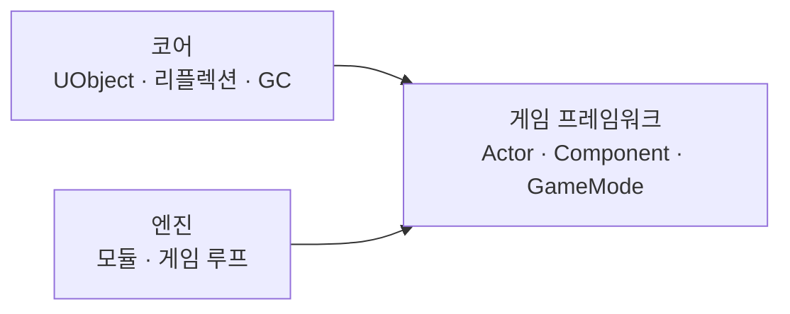

---
hide:
  - navigation
  - toc
---

Unreal Engine Architecture

# 언리얼 엔진 구조 학습 노트

엔진이 어떻게 짜여 있는지, 공부하면서 이해한 내용을 차곡차곡 쌓아두는 곳입니다.

## 코어

-   :material-file-document-multiple-outline:{ .lg } **[CDO (Class Default Object)](core/cdo.md)** 공부 중

    ---
    클래스마다 하나 있는 기본값 견본 객체와 델타 직렬화

-   :material-cube-outline:{ .lg } **[UObject와 리플렉션](core/uobject.md)** 시작 전

    ---
    UCLASS · UPROPERTY 매크로와 UHT가 만드는 리플렉션 정보

-   :material-recycle:{ .lg } **[가비지 컬렉션](core/garbage-collection.md)** 시작 전

    ---
    UPROPERTY 참조를 따라가는 마크-앤-스윕 GC

## 게임 프레임워크

-   :material-puzzle-outline:{ .lg } **[Actor와 Component](gameframework/actor-component.md)** 시작 전

    ---
    월드에 놓이는 Actor와 기능을 조립하는 Component

-   :material-gamepad-variant-outline:{ .lg } **[GameMode · GameState · PlayerController](gameframework/game-framework-classes.md)** 시작 전

    ---
    게임 규칙, 상태, 플레이어 입력의 역할 분담

## 엔진

-   :material-power:{ .lg } **[엔트리 포인트](engine/entry-point.md)** 공부 중

    ---
    WinMain → GuardedMain → FEngineLoop PreInit · Init · Tick · Exit

-   :material-package-variant-closed:{ .lg } **[모듈과 빌드 시스템](engine/modules.md)** 시작 전

    ---
    .Build.cs, UBT, 플러그인 구조

-   :material-sync:{ .lg } **[엔진 시작과 게임 루프](engine/engine-loop.md)** 시작 전

    ---
    GuardedMain → FEngineLoop → 매 프레임 Tick

## 학습 지도

??? tip "새 노트 추가하기"
    1. [노트 템플릿](template.md)을 복사해 `docs/<영역>/<주제>.md`로 저장
    2. `mkdocs.yml`의 `nav`에 추가
    3. 이 페이지에 카드 하나 추가 (상태 뱃지: `us-todo` 시작 전 · `us-doing` 공부 중 · `us-done` 정리 완료)
    4. 커밋 · 푸시하면 사이트가 자동 갱신됩니다
