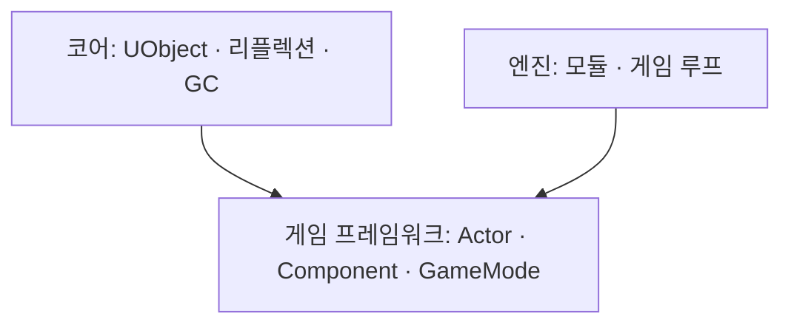

# 언리얼 엔진 구조 학습 노트

언리얼 엔진의 구조를 공부하면서 이해한 내용을 정리하는 공간입니다.

## 학습 지도

## 진행 상황

| 영역 | 주제 | 상태 |
|---|---|---|
| 코어 | [UObject와 리플렉션](core/uobject.md) | ⬜ |
| 코어 | [가비지 컬렉션](core/garbage-collection.md) | ⬜ |
| 게임 프레임워크 | [Actor와 Component](gameframework/actor-component.md) | ⬜ |
| 게임 프레임워크 | [GameMode · GameState · PlayerController](gameframework/game-framework-classes.md) | ⬜ |
| 엔진 | [모듈과 빌드 시스템](engine/modules.md) | ⬜ |
| 엔진 | [엔진 시작과 게임 루프](engine/engine-loop.md) | ⬜ |

상태: ⬜ 시작 전 · 🟨 공부 중 · ✅ 정리 완료

## 새 노트 추가하기

1. [노트 템플릿](template.md)을 복사해 `docs/<영역>/<주제>.md`로 저장
2. `mkdocs.yml`의 `nav`에 추가
3. 위 표에 한 줄 추가 후 커밋 · 푸시하면 사이트가 자동 갱신됩니다
